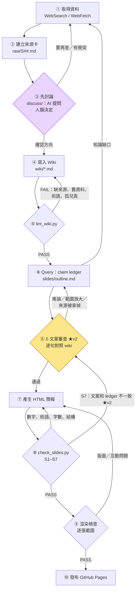

# Loop / Graph 設計與反思

## 1. 流程圖（workflow v2）

★ = 跑完 [run-001](../runs/run-001.md) 後新增或修改的部分。

**v1 → v2 的差別**：v1 是 ⑥ 只列事實 → ⑦ 直接寫 HTML → ⑧ 只檢查數字。v2 在中間插入 ⑥.5，並加上 S7 把 ⑧ 連回 ⑥.5。

## 2. 每個節點在做什麼

| 節點 | 輸入 | 輸出 | 檢查方式 |
|---|---|---|---|
| ① 取得資料 | 主題、知識缺口清單 | 網頁內容 | 有沒有日期、是否原始來源 |
| ② 來源卡 | 網頁 | `raw/S##.md` | 用自己的話整理、數字附時間、寫「限制」 |
| ③ 討論 | 來源卡 | `discuss/*.md` + 人類決定 | **人類**：方向、取捨、衝突怎麼處理 |
| ④ 寫 wiki | 來源卡 + 決定 | `wiki/*.md` | → ⑤ |
| ⑤ lint_wiki | wiki | PASS/FAIL | 每句有 [S##]、sources 一致、數字有時間、超過 3 年標舊、連結存在、無孤兒頁、粗體術語收進術語表、每頁都有「爭議與限制」 |
| ⑥ claim ledger | wiki | `outline.md` | 每張：教學問題 → wiki 頁 → 事實 [S##] |
| ⑥.5 文案審查 | ledger | 逐字文案 | 逐句對照 wiki：有沒有自己加推論、放大範圍、拿掉「某某認為」 |
| ⑦ 產生簡報 | 文案 | `index.html` | → ⑧ |
| ⑧ check_slides | HTML + ledger + wiki | PASS/FAIL | S1 有 data-wiki、S2 數字找得到、S3 ≤120 字、S4 教學結構、S5 術語用 `<dfn>` 解釋、S6 ledger 對應、S7 文案逐字一致 |
| ⑨ 渲染檢查 | 瀏覽器 | 13 張截圖 | 溢出偵測、JS 錯誤、逐張目視 |

## 3. 哪些步驟會重複執行？

| 回圈 | 什麼時候觸發 | run-001 實際次數 |
|---|---|---|
| ④ ⇄ ⑤ | lint FAIL | 2 次（11 項 → 0） |
| ⑦ ⇄ ⑧ | 數字／術語／字數 FAIL | 約 10 次 |
| ⑧ → ⑥.5 → ⑦ | S7 文案不一致 | 3 次 |
| ⑨ → ⑦ | 版面問題 | 2 次 |
| ③ → ① | 討論發現衝突要再查 | 1 次（S07 vs S08） |
| ⑥ → ① | 知識缺口 | 0 次（缺口記在 log，沒補） |

**整條流程**也會重複：每加一篇新來源，就從 ① 跑到 ⑤；要改簡報時從 ⑥ 開始。

## 4. 哪些地方需要檢查或重新生成？

- **③ 討論**一定要停下來等人類：數字衝突要用哪個、爭議要放多少，是價值判斷，不交給 AI。
- **⑤** 不通過就重寫 wiki，不能直接改簡報，否則簡報和 wiki 會對不上。
- **⑥ → ①**：wiki 沒有的資訊不准用模型記憶補，要回去找資料（本次選擇在簡報上直接說「還沒有來源」）。
- **⑥.5** 是 v2 新增的人工／AI 審查點；**S7** 保證審過的文案不會在 ⑦ 被偷偷改掉。

## 5. 為什麼這樣設計？

1. **分層**：raw（不改）→ wiki（整理）→ slides（呈現）。每一層只能從上一層取材，出錯時可以追到是哪一層。
2. **先討論後生成**：人類在 ③ 做取捨，AI 不會自己決定「哪個數字是對的」。
3. **能自動檢查的就寫成腳本**（引用、數字、術語、字數），讓回圈可以一直跑；**不能自動檢查的（語意）就放在最早、最好查的地方**——也就是文案還跟來源寫在一起的 ledger。
4. **把人類的決定變成規則**：round-01 決定「每個環節都要有爭議點」，就寫成 lint 規則，避免下次寫的時候忘記。

---

## 6. 反思

### Q1 哪一個節點最常出錯？
**⑦ 產生 HTML 簡報**，而且不是格式錯，是**語意漂移**：

- 數字一次都沒錯（S2 全部通過），但有 **6 句話的意思被改掉**：
  - 自己加推論：「第二週才是關鍵」
  - 範圍放大：「健康問題普遍」（原本是女性青少年練習生）、「常是早九晚十」（原本是某大公司）、「三冠王規則」（原本是部分節目）
  - 拿掉來源：「下一步是超級粉絲」（原本是高盛的看法）
  - 語氣加強：「常是解散原因」（原本是原因之一）
- 原因：簡報每張只能 120 字，**壓縮文字時最容易把「某些」變「全部」、把「某人認為」變成事實**。我甚至在修正一處漂移後、為了縮字又製造了一處新的。
- 次常出錯的是 ⑤ 的 wiki lint（11 項），但那些都是格式問題，腳本一抓就修好。

### Q2 發現問題後，把檢查往前移到哪一個步驟？
**從「⑧ 簡報產生之後」往前移到「⑥.5 claim ledger 階段」**：

- 原本：HTML 做完 → 自動檢查只看數字 → 人工最後才看語意，這時候文字已經離來源很遠。
- 現在：最終文案先寫在 `outline.md`，每句旁邊就是 wiki 頁和 [S##]，**在這裡審語意最容易**（來源就在旁邊）。HTML 只負責排版，不可以改字——S7 會擋。
- 我也試過把語意檢查自動化（字詞重疊率），結果 18 個警告全是誤報、真正的問題一個都沒抓到，所以決定**語意交給審查、一致性交給腳本**。

另一個往前移的例子：「S02 過時」在 ③ 討論時就發現了，但寫 wiki 時還是忘了標，到 ⑤ 才被抓到。所以把 round-01 的決定（每頁要有爭議段、舊資料要標記）直接寫進 lint 規則，讓「討論的結論」在寫的當下就被檢查。

### Q3 有沒有因此修改 workflow / graph？為什麼？
有，v1 → v2 改了四處：

| 修改 | 為什麼 |
|---|---|
| 新增節點 ⑥.5 文案審查 | 語意漂移發生在壓縮文字的時候，要在文字還跟來源放在一起時檢查 |
| 新增 S7（⑧ → ⑥.5 的回邊） | 審過的文案在排版時又被改（為了字數），需要機器擋住 |
| check_slides 修 3 個檢查器 bug／規則 | 誤判會讓人開始忽略警告：kicker 被當成數字、標籤黏字、參考資料頁不該限字數 |
| ⑨ 渲染檢查改成真的切換每一頁 | 第一次截圖 13 張都是第 1 張，原本的溢出檢查根本沒檢查到——**檢查本身也要被檢查** |

這次學到最重要的一點：**自動檢查 PASS 不等於內容正確**。數字檢查全過，但 6 句話的意思已經偏了。
